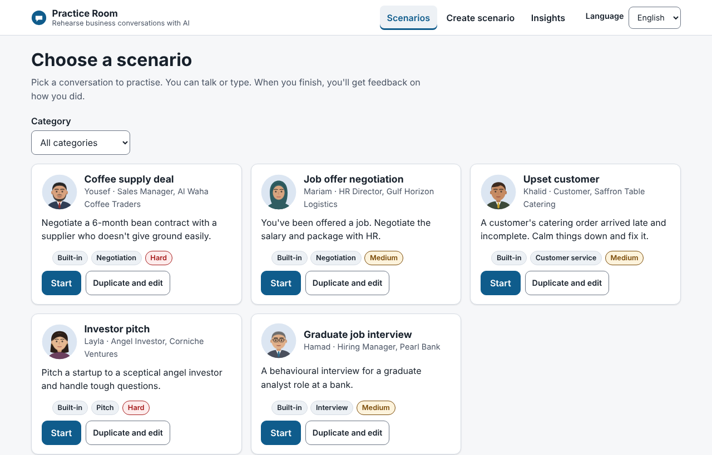
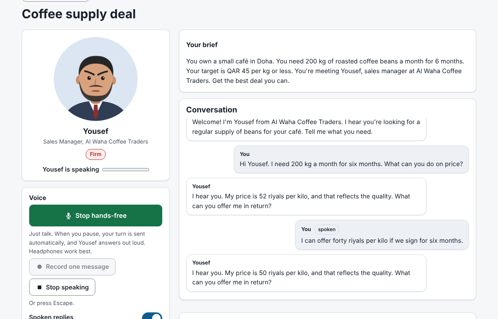
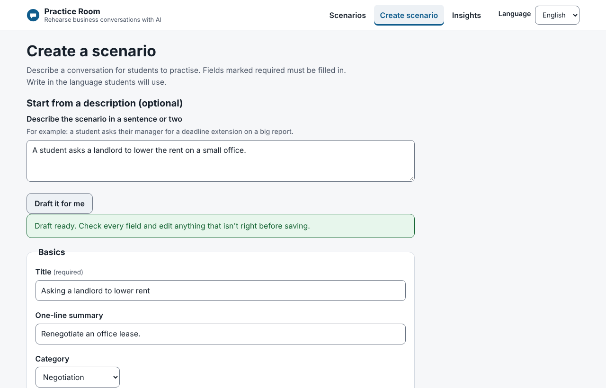
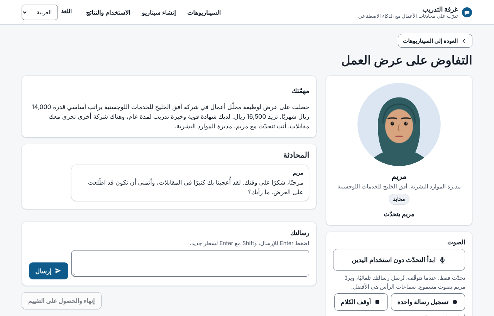

# Practice Room

Students practise business conversations with an AI character, by voice or text, then get specific feedback. It comes with five scenarios, and faculty can create their own in the browser.

| Built-in scenario | Character | Difficulty |
|---|---|---|
| Coffee supply deal (negotiation) | Yousef, supplier | Hard |
| Job offer negotiation | Mariam, HR director | Medium |
| Upset customer (service recovery) | Khalid, customer | Medium |
| Investor pitch | Layla, angel investor | Hard |
| Graduate job interview | Hamad, hiring manager | Medium |

All companies and people are fictional.



| Hands-free practice | Scenario builder | Arabic |
|---|---|---|
|  |  |  |

<sub>Screenshots taken in offline test mode, so the character's replies are canned.</sub>

## Run it

You need Python 3.10+ and a free Gemini API key from https://aistudio.google.com/apikey.

```bash
python -m venv .venv
source .venv/bin/activate            # Windows: .venv\Scripts\activate
pip install -r requirements.txt
cp .env.example .env                 # paste your key into .env
uvicorn server:app --reload
```

Open http://localhost:8000 in **Chrome or Edge**. Allow the microphone when asked.

- No key yet? Put `LLM_PROVIDER=fake` in `.env` to click through everything with canned replies.
- Tests: `pytest -q`

### Deploy

The repo includes `render.yaml` for [Render](https://render.com). In Render, choose **New > Blueprint**, pick this repo, and paste your Gemini key when asked. You get an HTTPS address, which browsers require for the microphone. The free plan sleeps when idle, so the first visit takes about 30 seconds to wake it.

## Using it

**Practising.** Pick a scenario and press Start. Then either:
- **Hands-free:** press *Start talking hands-free* and just talk. When you pause for about a second, your turn is sent automatically, the character answers out loud, and the app goes back to listening. Use headphones so the mic doesn't hear the character.
- **One message at a time:** *Record one message*, then *Stop and send*.
- **Type** in the message box.

*Stop speaking* (or Escape) cuts the character off. *Spoken replies* turns voice off. Press *End and get feedback* when you're done.

**Creating scenarios.** Go to *Create scenario*. Either fill in the form, or describe the scenario in a sentence and press *Draft it for me*, then edit what the AI drafted. Built-in scenarios can't be edited, but *Duplicate and edit* makes a copy you can change.

**Insights** shows sessions, scores, results reached, reply time and AI cost per scenario.

## How it's built

| File | What it does |
|---|---|
| `server.py` | FastAPI web server and API routes |
| `engine.py` | Sessions, the streamed voice/text turn, grading, usage logging |
| `llm.py` | Every AI call goes through here: chat, grading, drafting, speech in and out. Retries, fallbacks, cost logging |
| `scenarios/` | The scenario format, prompts, and the rules for negotiated numbers. Built-in scenarios are JSON files in `scenarios/presets/` |
| `config.py` | Models, prices, voices, limits |
| `static/` | The web page: `js/app.js` (views), `js/audio.js` (playback and hands-free mic), `js/avatar.js` (faces), `i18n/` (English and Arabic text) |
| `tests/` | Offline tests for parsing, the number rules, voice turns and arithmetic |

### Why replies are faster than the first version

The first version took 5–6 seconds because it did everything one step at a time: transcribe, then reply, then voice the whole reply, then reload the page. Now:

1. **One call instead of two.** The recording goes straight to the chat model, which writes down what it heard and replies in the same call.
2. **Streaming.** The reply arrives word by word. As soon as the first sentence is complete, it's sent off to be voiced while the rest is still being written.
3. **Sentence-by-sentence audio.** The browser starts playing sentence one while later sentences are still on their way.
4. **Fastest settings.** The chat model runs with minimal thinking, and the fastest voice provider is tried first.

What's left is mostly the ~0.8 seconds of silence the app waits for before deciding you've finished talking (`silenceMs` in `static/js/audio.js`), plus network time. For sub-second replies, the next step would be Gemini's Live API, which streams audio both ways continuously.

### Negotiation limits are enforced in code

For scenarios with a number (a price, a salary), the character states its position in a hidden tag every turn. Before anything is shown or spoken, the server checks it:
- no movement on the student's first message,
- no move bigger than the allowed step in one reply,
- never past the absolute limit.

If the AI breaks a rule, its reply is thrown away and regenerated with a correction. If it breaks the rule twice, a fixed "I can't move on that" line is used. Students can't argue or trick the character past its limits.

### Other design decisions

- **Hidden fields stay on the server.** Students' browsers never receive the character's private information, limits or grading rubric.
- **Model routing.** Conversation runs on the cheapest, fastest model. Grading and drafting use a stronger one.
- **Voice fallback chain.** Edge voices (fast, free, include Qatari Arabic) are tried first, then Gemini TTS. If both fail, the character replies in text and the student sees a short notice.
- **The maths isn't done by the AI.** The grader reads the agreed number out of the conversation. Totals, gap to target and money left on the table are calculated in Python.
- **Privacy.** Logs hold counts, scores, timings and costs, never what students said. Session IDs are random.
- **Bilingual.** All interface text lives in `static/i18n/`. Characters reply in whichever language the student uses.

## Accessibility (WCAG 2.1 AA)

**Built in:**
- Everything works with a keyboard: skip link, visible 3px focus outlines, focus moved to each new page's heading, Escape to stop speech.
- Voice is never required. Typing works everywhere, and everything the character says is shown as text.
- Audio only plays after the student starts a scenario, and can be stopped (Stop speaking button or Escape) or switched off (WCAG 1.4.2).
- Screen readers: each finished reply is announced once (not word by word while streaming), along with status changes like "Listening" and "thinking". The avatar has a text label that includes the current mood, and mood is shown as a word, not just a colour.
- Colour contrast checked in light and dark mode. Works in Windows high-contrast mode.
- Reflows at 320px wide and at 200% text size with no sideways scrolling.
- Forms: every field has a visible label and hint. Errors are listed at the top with links to each field, and marked on the field itself.
- Page language and direction switch properly for Arabic (`lang="ar"`, right-to-left).
- Animations stop for users with reduced motion turned on.

**Tested:**
- The axe-core automated checker (WCAG 2.0/2.1/2.2 A and AA rules) found **0 violations** on every view (library, practice, feedback, builder with errors, insights) in English and Arabic, light and dark mode.
- Keyboard-only walkthrough in Playwright.
- Reflow at 320px and 200% zoom checked.

**Not yet done.** Automated tools only catch part of WCAG, so this is not a compliance claim. Before real use it needs:
- a manual check with a screen reader (NVDA, VoiceOver),
- testing by disabled users,
- a review of the hands-free mode with assistive technology.

## How it was built

I built this over three iterations in one week: a text-only Streamlit prototype, then voice and an animated avatar, then a rebuild on FastAPI with a hand-built front end, because Streamlit couldn't support hands-free voice, low latency or full keyboard and screen-reader access. The git history keeps the prototype so the change is visible.

## Known limits

- Built and tested offline with stand-in AI replies and a fake microphone. The live Gemini and voice calls haven't been tested yet.
- Edge voices use an unofficial interface to Microsoft's read-aloud service. Fine for a demo. For production, use Gemini TTS or a paid speech service.
- Sessions live in server memory. A restart ends them, and it runs as one process. Real use needs a database.
- No sign-in. Anyone can create or edit custom scenarios, and the builder can read hidden fields. A real version would put this behind university SSO, with only faculty able to author.
- Custom scenarios are written in one language. Built-in ones have English and Arabic versions.
- The free Gemini tier may use inputs to improve Google's products. Real student data should go through the paid tier or a provider covered by the university's data agreement.
- Arabic text should be reviewed by a native speaker.
